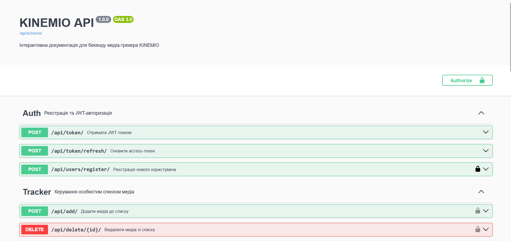
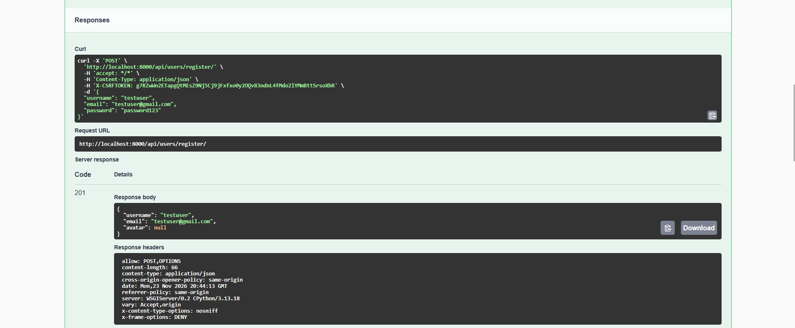
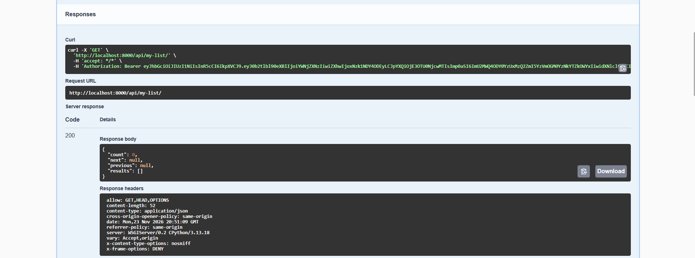
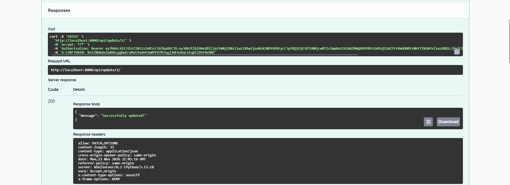
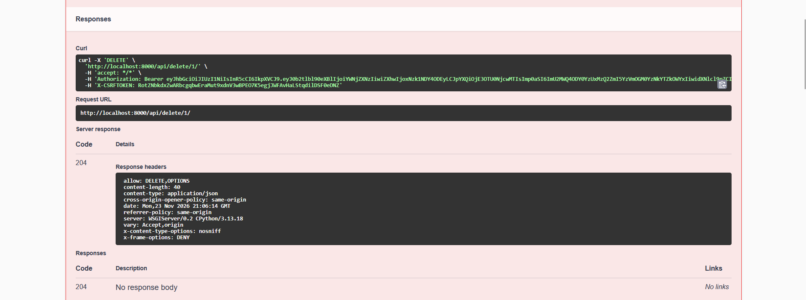
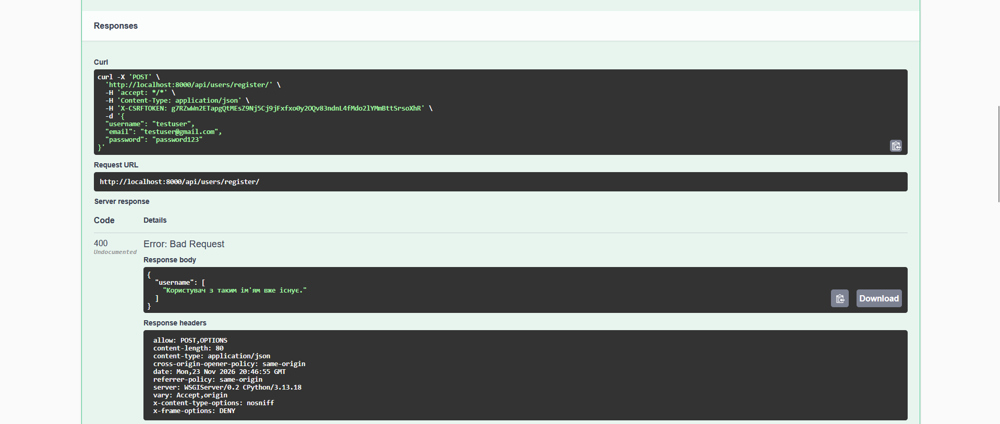
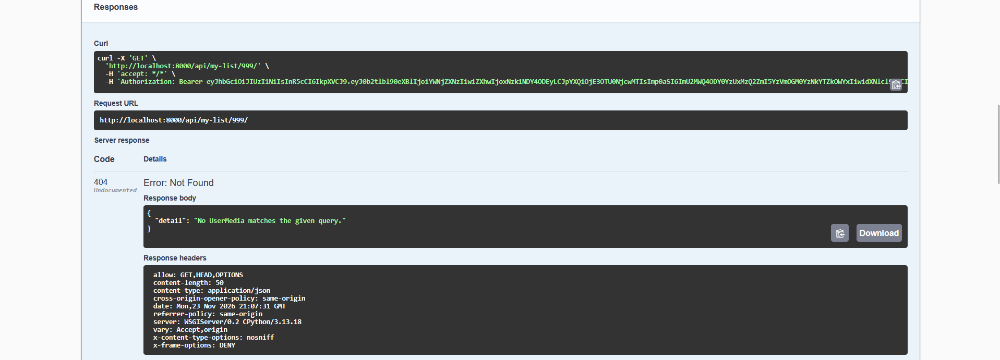

# Звіт з лабораторної роботи 1

## Тема роботи: Розроблення backend архітектури та основного функціоналу

Здобувач освіти: Фищук Богдан Сергійович  
Група: ІПЗ-41  
GitHub репозиторій: https://github.com/Retr0SE/MediaTracker.git

## Виконання роботи

### Предметна область
Для виконання лабораторної роботи обрано предметну область вебсервісу **KINEMIO** — платформи для каталогізації та відстеження прогресу споживання медіаконтенту (фільмів, серіалів, тощо), ведення персональних списків, виставлення оцінок та соціальної взаємодії між користувачами.

### Налаштування проєкту
- Створено Git репозиторій та налаштовано файл `.gitignore`
- Ініціалізовано серверний проєкт на базі **Python / Django / Django REST Framework**
- Встановлено необхідні залежності (`django`, `djangorestframework`, `psycopg2-binary`, `drf-spectacular`, `django-cors-headers`, `django-redis` тощо)
- Налаштовано конфігурацію середовища через файл `.env` та контейнеризацію за допомогою Docker і Docker Compose
- Організовано модульну структуру файлів проєкту

### База даних
- Налаштовано підключення до реляційної СУБД **PostgreSQL**
- Спроєктовано та реалізовано моделі даних через **Django ORM**:
  - `CustomUser` — облікові записи користувачів, ролі та профілі;
  - `MediaItem` — каталог медіаконтенту (назва, тип, опис, рік випуску, постер, кількість епізодів/сторінок);
  - `UserMedia` — проміжна модель зв'язку користувача з медіа (статус перегляду/читання, оцінка, прогрес, дата оновлення);
  - `Friendship` — модель дружніх зв'язків та запитів між користувачами.
- Реалізовано зв'язки типів **один-до-багатьох (1:N)** (`CustomUser` → `UserMedia`, `MediaItem` → `UserMedia`) та **багато-до-багатьох (M:N)** (`CustomUser` ↔ `MediaItem` через проміжну таблицю `UserMedia` з обмеженням унікальності, `CustomUser` ↔ `CustomUser` через `Friendship`)
- Згенеровано та виконано міграції бази даних (`makemigrations`, `migrate`)

### Backend архітектура
- Налаштовано сервер **Django + Django REST Framework (DRF)**
- Реалізовано архітектуру **MVT / REST API** із чітким розділенням відповідальності:
  - `models.py` — рівень роботи з даними (ORM);
  - `serializers.py` — серіалізація JSON та валідація вхідних даних;
  - `views.py` — контролери (`ModelViewSet`, `APIView`) для обробки CRUD-операцій;
  - `urls.py` — маршрутизація RESTful endpoints через `DefaultRouter`.
- Впроваджено middleware (CORS, автентифікація, безпека) та централізовану обробку помилок зі стандартизованими HTTP-кодами (`200`, `201`, `204`, `400`, `401`, `403`, `404`)
- Підключено автоматичну генерацію інтерактивної документації API у форматі OpenAPI 3.0 (**Swagger UI**) за допомогою `drf-spectacular`

### API endpoints

#### Користувачі та соціальна взаємодія (`users`)

| Метод | Endpoint | Опис операції |
| :--- | :--- | :--- |
| `POST` | `/api/users/register/` | Реєстрація нового користувача |
| `GET` / `PATCH` | `/api/users/profile/` | Отримання та оновлення профілю поточного користувача |
| `GET` | `/api/users/profile/stats/` | Отримання статистики активності користувача |
| `GET` | `/api/users/search/` | Пошук користувачів |
| `GET` | `/api/users/friends/` | Отримання списку друзів / підписок користувача |
| `POST` | `/api/users/{user_id}/follow/` | Підписка або відписка від користувача (toggle дружби) |
| `GET` | `/api/users/{user_id}/` | Отримання публічної інформації про конкретного користувача |

#### Трекер медіа та каталог (`tracker`)

| Метод | Endpoint | Опис операції |
| :--- | :--- | :--- |
| `GET` | `/api/my-list/` | Отримання персонального списку медіа (з фільтрацією/пагінацією) |
| `GET` | `/api/my-list/all/` | Отримання повного списку всіх медіа користувача |
| `GET` | `/api/my-list/{pk}/` | Отримання детальної інформації про запис у списку користувача |
| `POST` | `/api/add/` | Додавання медіаконтенту до списку користувача |
| `PUT` / `PATCH` | `/api/update/{pk}/` | Оновлення статусу, оцінки або прогресу запису |
| `DELETE` | `/api/delete/{pk}/` | Видалення запису зі списку користувача |
| `GET` | `/api/catalog/search/` | Live-пошук медіаконтенту по каталогу |
| `GET` | `/api/catalog/{pk}/` | Отримання детальної інформації про тайтл із каталогу |
| `GET` / `POST` | `/api/catalog/{media_item_id}/reviews/` | Перегляд та додавання відгуків до конкретного тайтла |
| `GET` | `/api/users/{user_id}/media/` | Перегляд списку медіа іншого користувача (друга) |

#### Документація API

| Метод | Endpoint | Опис операції |
| :--- | :--- | :--- |
| `GET` | `/api/schema/swagger-ui/` | Інтерактивна документація REST API (Swagger UI) |

## Структура проєкту

```text
kinemio/
├── .github/
│   └── workflows/
├── backend/
│   ├── config/
│   │   ├── __init__.py
│   │   ├── settings.py
│   │   ├── urls.py
│   │   ├── wsgi.py
│   │   └── asgi.py
│   ├── media/
│   │   └── avatars/
│   ├── tracker/
│   │   ├── migrations/
│   │   ├── __init__.py
│   │   ├── admin.py
│   │   ├── apps.py
│   │   ├── models.py
│   │   ├── serializers.py
│   │   ├── tests.py
│   │   ├── utils.py
│   │   ├── views.py
│   │   └── urls.py
│   ├── users/
│   │   ├── migrations/
│   │   ├── __init__.py
│   │   ├── admin.py
│   │   ├── apps.py
│   │   ├── models.py
│   │   ├── serializers.py
│   │   ├── tests.py
│   │   ├── utils.py
│   │   ├── views.py
│   │   └── urls.py
│   ├── .dockerignore
│   ├── Dockerfile
│   ├── manage.py
│   └── requirements.txt
├── frontend/
├── reports/
│   ├── screenshots/
│   └── lab1-report.md
├── .env.example
├── .gitignore
├── docker-compose.yaml
└── README.md
```

## Скріншоти тестування

### Документація API (Swagger UI)


### Створення запису (POST — 201 Created)


### Отримання даних (GET — 200 OK)


### Видалення (DELETE)


### Оновлення (PATCH)


### Перевірка валідації даних (400 Bad Request)


### Обробка неіснуючого ресурсу (404 Not Found)


## Висновки

У ході виконання лабораторної роботи було спроєктовано та реалізовано серверну архітектуру вебдодатку **KINEMIO** з використанням **Python, Django, Django REST Framework та PostgreSQL**. Створено реляційну структуру бази даних зі зв'язками 1:N та M:N, налаштовано роботу зі змінними середовища, реалізовано повний набір CRUD-операцій з валідацією вхідних даних та коректною обробкою помилок, а також підключено інтерактивну документацію OpenAPI (Swagger UI) за допомогою `drf-spectacular`.

Самооцінка: 5

Обґрунтування: Усі технічні вимоги лабораторної роботи виконано в повному обсязі. Реалізовано чисту модульну backend-архітектуру з підключенням до PostgreSQL через ORM, повним циклом CRUD-операцій, багаторівневою валідацією даних на рівні серіалізаторів, коректною обробкою HTTP-помилок, конфігурацією через змінні середовища та автоматично згенерованою документацією Swagger UI. Усі ключові ендпоінти протестовано та задокументовано.