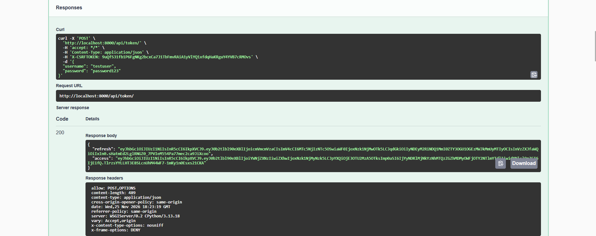
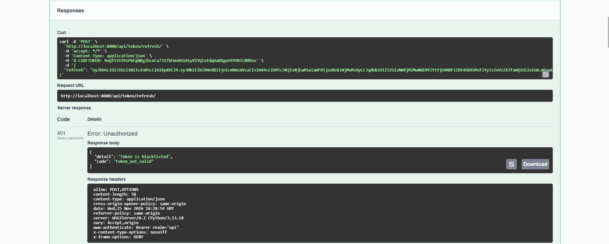
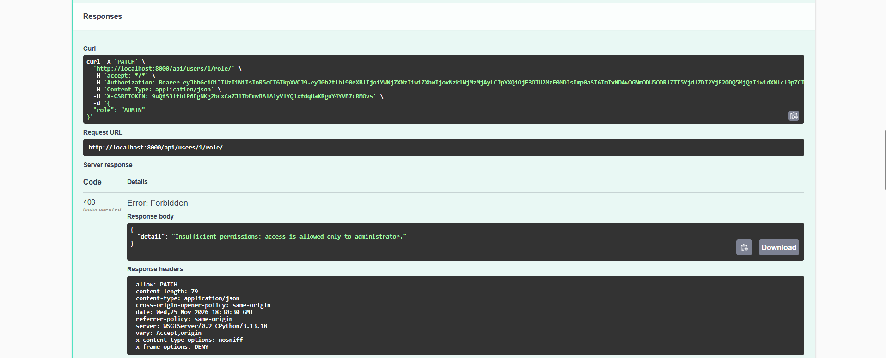
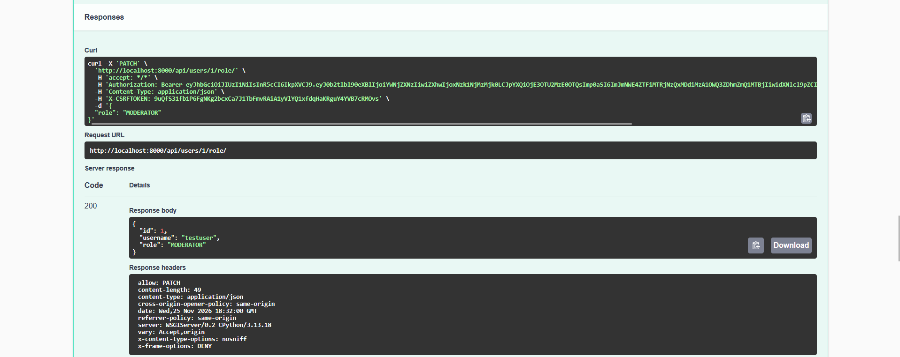
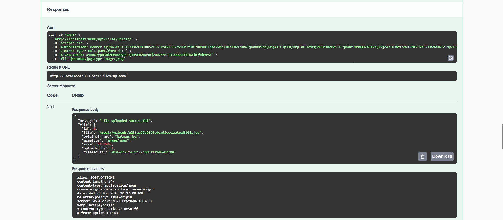
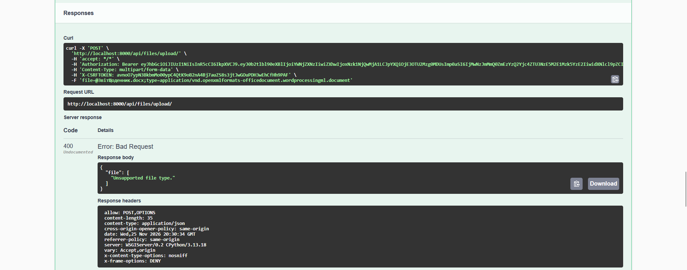
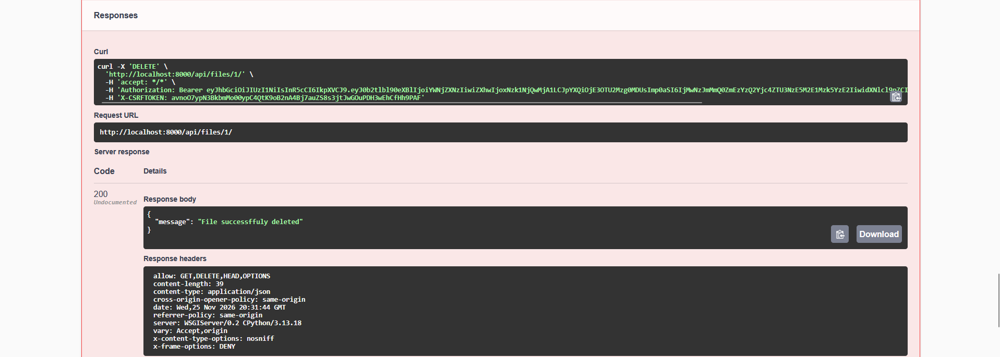
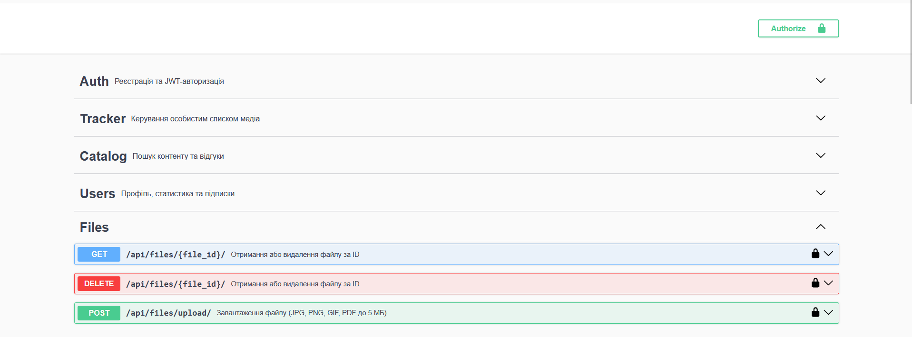
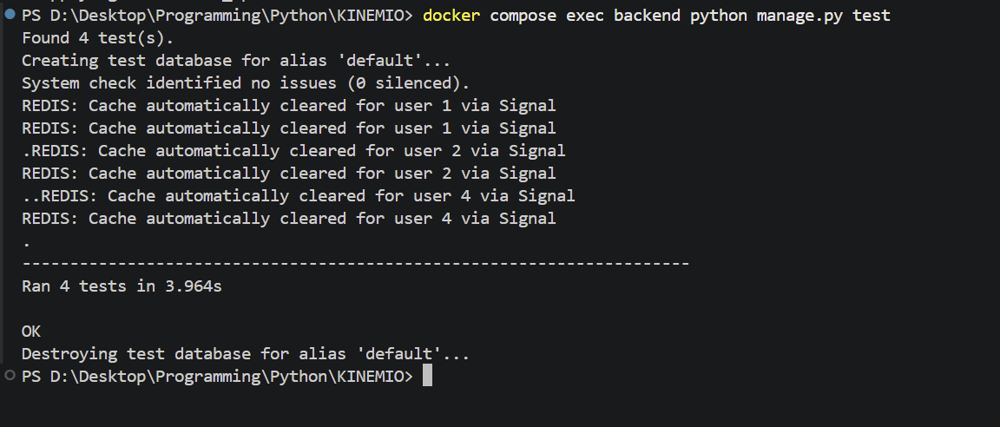

# Звіт з лабораторної роботи 2

## Тема роботи: Аутентифікація, авторизація та розширений функціонал

**Здобувач освіти:** Фищук Богдан Сергійович  
**Група:** ІПЗ-41  
**GitHub репозиторій:** https://github.com/Retr0SE/MediaTracker.git
**Рівень складності:** 3 (Високий)

## Реалізований функціонал

Роботу виконано на базі backend-проєкту **KINEMIO** (Python, Django, Django REST Framework, PostgreSQL, Redis):

- **JWT-аутентифікація з ротацією та відкликанням токенів:** налаштовано `djangorestframework-simplejwt` із `token_blacklist` (`ROTATE_REFRESH_TOKENS`, `BLACKLIST_AFTER_ROTATION`), валідацією довжини пароля (від 8 символів) та ендпоінтом `POST /api/users/logout/`.
- **Хешування паролів (Argon2id):** підключено `argon2-cffi` з `Argon2PasswordHasher` як основним алгоритмом та `PBKDF2PasswordHasher` для зворотної сумісності.
- **Система ролей (RBAC):** додано поле `role` (`USER`, `MODERATOR`, `ADMIN`) до моделі `CustomUser`, створено кастомні дозволи (`IsAdmin`, `IsAdminOrModerator`, `IsOwnerOrAdmin`) у `users/permissions.py` та захищений ендпоінт `PATCH /api/users/{user_id}/role/`.
- **Файловий сервіс із валідацією:** реалізовано модель `UploadedFile` та маршрути `POST /api/files/upload/`, `GET /api/files/{file_id}/`, `DELETE /api/files/{file_id}/` із перевіркою розміру (до 5 МБ), розширення й MIME-типу (`JPG`, `PNG`, `GIF`, `PDF`), а також прав власника при видаленні.
- **Пошук, фільтрація та пагінація:** налаштовано `PageNumberPagination` (`PAGE_SIZE = 12`), `DjangoFilterBackend`, `SearchFilter` та `OrderingFilter`.
- **Безпека API та документація:** активовано `SecurityMiddleware`, налаштовано `django-cors-headers`, додано Rate Limiting (`AnonRateThrottle`, `UserRateThrottle`) на базі Redis та інтерактивну документацію OpenAPI 3.0 (`drf-spectacular`).

## Ключові фрагменти коду

### 1. Хешування Argon2id, JWT-ротація та Rate Limiting (`backend/config/settings.py`)

```python
PASSWORD_HASHERS = [
    'django.contrib.auth.hashers.Argon2PasswordHasher',
    'django.contrib.auth.hashers.PBKDF2PasswordHasher',
]

SIMPLE_JWT = {
    'ACCESS_TOKEN_LIFETIME': timedelta(minutes=30),
    'REFRESH_TOKEN_LIFETIME': timedelta(days=7),
    'ROTATE_REFRESH_TOKENS': True,
    'BLACKLIST_AFTER_ROTATION': True,
}

# У блоці REST_FRAMEWORK:
'DEFAULT_THROTTLE_RATES': {
    'anon': '30/minute',
    'user': '100/minute',
}
```

### 2. Перевірка ролей RBAC (`backend/users/permissions.py`)

```python
class IsAdmin(BasePermission):
    def has_permission(self, request, view):
        return bool(
            request.user.is_authenticated
            and (request.user.role == 'ADMIN' or request.user.is_superuser)
        )
```

### 3. Відкликання Refresh-токена (`backend/users/views.py`)

```python
class LogoutAPIView(APIView):
    permission_classes = [AllowAny]

    def post(self, request):
        try:
            RefreshToken(request.data.get('refresh')).blacklist()
            return Response(status=status.HTTP_204_NO_CONTENT)
        except TokenError:
            return Response({'error': 'Invalid token'}, status=status.HTTP_401_UNAUTHORIZED)
```

### 4. Валідація завантажених файлів (`backend/users/validators.py`)

```python
def validate_uploaded_file(file):
    if file.size > 5 * 1024 * 1024:
        raise serializers.ValidationError('Файл занадто великий (максимум 5 МБ).')
    ext = os.path.splitext(file.name)[1].lower()
    if ext not in ALLOWED_FILE_TYPES.get(file.content_type, []):
        raise serializers.ValidationError('Непідтримуваний тип файлу.')
    return file
```

## Скріншоти

### 1. Вхід у систему та отримання пари JWT-токенів


### 2. Відкликання Refresh-токена через Logout (`204`) та блокування повторного використання (`401`)


### 3. Перевірка ролей RBAC (`403 Forbidden` для `USER` та `200 OK` для `ADMIN`)



### 4. Файловий сервіс: завантаження (`201`) та відхилення невалідного типу (`400`)



### 5. Видалення файлу (`200 OK`)


### 6. Документація Swagger UI


### 7. Результати виконання автоматичних тестів


## Висновки

У ході виконання лабораторної роботи №2 посилено безпеку та розширено функціонал backend-частини проєкту **KINEMIO**. Реалізовано JWT-аутентифікацію з ротацією й чорним списком refresh-токенів, хешування паролів Argon2id, рольову модель доступу (RBAC), файловий сервіс із подвійною валідацією, Rate Limiting на базі Redis та повну документацію API у Swagger UI.

**Самооцінка:** 5 (Відмінно)

**Обґрунтування:** виконано всі вимоги методички з адаптацією під стек Django/DRF, включно з ротацією токенів, Argon2id, RBAC, файловим сервісом, захисними заголовками, CORS, Rate Limiting через Redis, OpenAPI-документацією та автотестами.